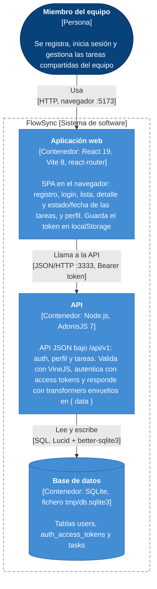

# Arquitectura de FlowSync

Diagrama de contenedores (nivel 2 del modelo C4) de FlowSync tal como está hoy en el código: la persona que lo usa, los tres contenedores del sistema (la SPA de React en `frontend/`, la API de AdonisJS en `backend/` y la base de datos SQLite que crean sus migraciones) y cómo se comunican. No aparece ningún sistema externo porque el código no llama a ninguno. Se dibuja con un `flowchart` de Mermaid en vez de con los elementos `C4Container`, que todavía están en beta y se ven mal, pero mantiene la notación C4: cada caja indica su tipo y su tecnología, el límite del sistema es un `subgraph` y cada flecha dice qué se hace y por qué protocolo.

